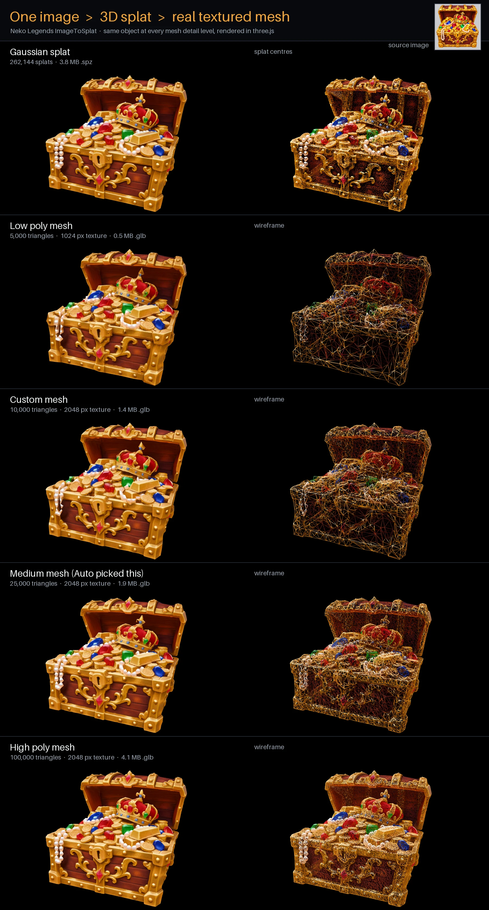

# ImageToSplat (Neko Splat Forge)

Turn **one image** into a **3D Gaussian splat** and a **real textured mesh**, on your own GPU. Part of the
[Neko Legends](https://github.com/neko-legends) tools.



One stylized chest image in, about a minute later:

| File | What it is | Chest example |
|---|---|---|
| `<name>.spz` | compressed splat (Spark, three.js) | 3.8 MB |
| `<name>_native.ply`, `.splat` | splat in the standard formats | 17.8 MB, 8.4 MB |
| `<name>_mesh.glb` | **real textured mesh**, detail of your choice | 0.5-4.1 MB |
| `<name>_point_cloud.glb/.obj/.fbx`, glTF `.zip` | splat centres as a coloured point cloud | 4-17 MB |

The splat is made by [TripoSplat](https://github.com/VAST-AI-Research/TripoSplat) (TripoAI, MIT); the desktop app,
the mesh export, the `.spz` export, the viewers and the Agent API are ours.

## Try the demo (no GPU, nothing to install)

The chest above is in the repo. Clone it and run:

```bash
python demo/run_demo.py
```

Your browser opens a three.js page: buttons (or keys 1-5) switch between the splat and the four meshes with the
same camera, W shows the wireframe. It needs an internet connection (three.js and Spark come from a CDN).

## Install

**Linux (AppImage)**: get it from [Releases](../../releases) or install it with
[Neko Legends Control Center](https://github.com/neko-legends/neko-legends-control-center). You need:

- an NVIDIA GPU with current drivers (8 GB VRAM or more);
- [uv](https://docs.astral.sh/uv/) on your `PATH` (Omarchy has it). On first start the app uses it to create a
  Python environment with PyTorch (several GB, a few minutes; the window shows the progress);
- for the mesh export: the CUDA toolkit (`nvcc`, e.g. the `cuda` package on Arch) and a C++ compiler. gsplat
  compiles its GPU code once on first use. Without them you still get the splat, and the job reports `meshError`.

Then press **Setup models** once (3.6 GB from Hugging Face) and choose an image.

Everything the app writes goes to `~/.local/share/NekoLegends/ImageToSplat` (environment, models, outputs,
`service.log`). Change it with:

| Variable | Meaning |
|---|---|
| `IMAGETOSPLAT_DATA_DIR` | the whole data folder |
| `IMAGETOSPLAT_ENV_DIR` | only the Python environment |
| `IMAGETOSPLAT_PYTHON` | use this Python as it is, install nothing (needs `requirements-app.txt`) |
| `TRIPOSPLAT_CKPTS` | only the model folder |
| `IMAGETOSPLAT_OUTPUT_DIR` | default output folder (each job can also choose its own) |

**From source** (any OS with a CUDA PyTorch):

```bash
pip install -r requirements-app.txt
python run_gradio.py --serve-agent-api       # the local service the desktop app talks to
npm install && npm run tauri:dev             # the desktop app
# or without the desktop app:
pip install gradio && python run_gradio.py   # browser UI
python run_gradio.py --headless chest.png --output-dir out --output-name chest --mesh-detail low
```

Model files go to `ckpts/` beside the code (or `TRIPOSPLAT_CKPTS`); the app's **Setup models** button or
`hf download VAST-AI/TripoSplat --local-dir ckpts/` fetches them.

## Real 3D mesh export

TripoSplat makes Gaussian splats, not polygons, so the app also turns every result into an ordinary textured mesh
that Blender, game engines and three.js (`GLTFLoader`) open like any model:

1. the splat is rendered (colour and depth) from 128 directions around the object;
2. the depth maps are fused into a signed-distance volume (TSDF, 256³), with the silhouettes carving away empty space;
3. marching cubes extracts the surface, small floating pieces are dropped, and the mesh is simplified to the
   chosen triangle count;
4. xatlas unwraps it, and every texel of the texture is moved onto the full-detail surface and takes the colour of
   the 1024 px splat renders that see that point most head-on, so a low-poly mesh keeps the texture detail.

Mesh detail (the **Mesh** setting in the app, `meshDetail` in the API, `--mesh-detail` on the command line):

| Detail | Triangles | Texture | Chest `.glb` |
|---|---|---|---|
| `low` | 5,000 | 1024 px | 0.5 MB |
| `medium` | 25,000 | 2048 px | 1.9 MB |
| `high` | 100,000 | 2048 px | 4.1 MB |
| `auto` (default) | the fewest of 3k-100k that keep 95 % of the surface within 0.3 % of the object's size | 2048 px | 1.9 MB (picked 25k) |
| custom | `meshFaces` / `--mesh-faces N` | 2048 px | 10k: 1.4 MB |

**Rebuild mesh** in the app (or `POST /mesh`) makes the mesh again from the existing splat in 5-45 s without
generating again. The preview switches between **Splat** and **Mesh (.glb)**.

The `.glb` is y-up, stands on y = 0 with its front facing +z, and uses an unlit material (`KHR_materials_unlit`):
the texture already contains the shading and highlights of the source image, so lighting it again would wash it
out. A texture keeps more detail than a colour per vertex at less than half the size (left: 514k triangles with
vertex colours, 10 MB; right: 100k triangles textured, 4 MB):


Convert any splat yourself:

```bash
python -m scene_splat --mesh chest_native.ply                     # -> chest_mesh.glb (high: 100k triangles)
python -m scene_splat --mesh chest_native.ply --mesh-detail low    # 5k triangles, 1024 texture
python -m scene_splat --mesh chest_native.ply --mesh-faces 12000   # exact triangle count
python -m scene_splat --mesh chest_native.ply --mesh-texture 0     # vertex colours, no simplification
python -m scene_splat --mesh scene.spz --mesh-up y --mesh-yaw 0    # a .spz that is already y-up
```

Limits: the model invents the sides the image does not show; thin parts (cloth, hair, leaves) can close up or get
holes; the lighting is baked in. Making the splat from an AI 360 degree video instead of one image was tested and
dropped: sharper only from the filmed angles, smeared everywhere else.

### Comparing results in three.js

`public/viewer/compare.html?set=<list.json>` switches between a splat and any number of meshes with one camera
and a wireframe toggle; it is the page the demo opens. The list is
`[{"label": "Low", "url": "chest_low.glb"}, {"label": "Splat", "url": "chest.spz"}]`, with file names relative
to the list.

## Agent API

The desktop app talks to a local service on `127.0.0.1` (default port `17340`, listed in the Neko Legends agent
registry: `~/.config/NekoLegends/agent-api-registry.json` on Linux, `%APPDATA%\NekoLegends\` on Windows).
AI agents and scripts can use the same service:

| Endpoint | |
|---|---|
| `GET /health`, `GET /status`, `GET /models`, `GET /openapi.json` | state, job progress and results |
| `POST /setup` | download missing model files |
| `POST /generate` | image to splat and mesh |
| `POST /mesh` | rebuild the mesh of a splat with other options |

```bash
curl -X POST http://127.0.0.1:17340/generate -H 'Content-Type: application/json' -d '{
  "imagePath": "/path/to/chest.png", "outputDir": "/path/to/out", "outputName": "chest",
  "seed": 42, "steps": 20, "guidanceScale": 3.0, "numGaussians": 262144,
  "meshDetail": "auto" }'
curl http://127.0.0.1:17340/status      # poll: activeJob.progress, then lastJob.result.paths
curl -X POST http://127.0.0.1:17340/mesh -H 'Content-Type: application/json' -d '{"meshDetail": "low"}'
```

`/generate` options: `mesh` (false to skip the mesh), `meshDetail` (`auto`, `low`, `medium`, `high`), `meshFaces`
(exact triangle count), `meshTexture` (texture size; 0 = colour per vertex). `/mesh` takes the same mesh options
plus `plyPath` (default: the last generated splat) and `outputPath`.

Start it yourself with `python run_gradio.py --serve-agent-api [--agent-api-port N]`, or beside the browser UI
with `--agent-api`. Environment: `TRIPOSPLAT_AGENT_API=1`, `TRIPOSPLAT_AGENT_API_PORT`, `TRIPOSPLAT_HEADLESS=1`,
`TRIPOSPLAT_OPEN_BROWSER=0`, `TRIPOSPLAT_PORT` (browser UI port).

## Room / Scene Mode (experimental: command line and Agent API only)

Single-image mode guesses the hidden sides of one object. Scene mode instead rebuilds a **room or any still scene**
from video, so you can walk through it in three.js:

1. **Video in.** Use your own clips of a still scene (several clips of one room are joined), or let
   [Venice Media Local](https://github.com/neko-legends/venice-media-local) film it:
   - give a room image (or a prompt, and `gpt-image-2-6-sunburst` draws it);
   - Sunburst edit first draws one wide panorama of the whole room, then draws the room from three more directions
     using that panorama, so every view agrees on where things are (views edited one by one put the same bookshelf
     in different places, and the splat then smears the versions together);
   - Flux 3 first/last-frame films a fast 5 s turn from each view to the next, closing the loop
     (`captureMode: "first-last"`, the default), or Seedance 2.5 reference-to-video makes one spin through all
     views (`captureMode: "reference"`). Longer turns (180 degrees in one clip) dissolve, and more, smaller turns
     invent more in-between content, so four 90 degree turns work best.
2. **Every clip is inspected** before use (hard cuts, cross-fades, a camera that barely moves). AI video does not
   always follow the prompt; a Venice clip that fails is filmed again once, and every clip gets a contact sheet in
   `<name>.clips/`.
3. **Camera positions** are solved across all clips with COLMAP (pycolmap, default, best quality). Each frame gets
   its own focal length and lens distortion, because AI video zooms while it moves (one Flux clip drifted 28 % in
   focal length; one shared lens bent the room). The result is levelled (the average camera "up" becomes +y) so the
   viewer starts upright and walking stays on the floor. Alternatively, solve with
   MapAnything (`sfm: "mapanything"`, about twice as fast overall: one GPU pass instead of CPU matching; training then
   also refines each camera). In one 200-frame room test: COLMAP 14 min, 20.2 dB; MapAnything 7.4 min, 19.1 dB.
4. **Splats are trained on the GPU** with gsplat (MCMC, capped splat count, light colour detail). Frames that keep
   disagreeing with the rest (a clip that jumps or morphs for a moment) are dropped part-way through and listed in
   `droppedFrames`; splats sitting on top of a camera and huge blurry blobs are removed. The result is saved as a
   compressed **`.spz`** (a room is about 5-15 MB instead of 350-600 MB of `.ply`) plus `<name>.cameras.json`, the
   filmed camera path in three.js coordinates (y up). The splat is already y-up; load it with Spark
   (`new SplatMesh({ url: "room.spz" })`) and start the player at `cameras[0]`.

The viewer opens a scene with `viewer.html?ply=<room.spz>&cams=<room.cameras.json>`: drag to look around,
W/A/S/D to walk, Q/E down/up.

### Scene requirements

Scene work runs in a separate Python worker so the main app does not need these packages:

```bash
# Python 3.12 environment with CUDA PyTorch for your GPU, then:
pip install -r requirements-scene.txt
python -m scene_splat --check      # reports ffmpeg, pycolmap, torch/CUDA, gsplat
```

gsplat compiles its CUDA kernels on first use, so a CUDA toolkit (`nvcc`) is needed once; the worker finds it via
`CUDA_HOME`, `nvcc` on `PATH`, `/opt/cuda` or `/usr/local/cuda`. Point the app at that environment with
`IMAGETOSPLAT_SCENE_PYTHON=/path/to/python`. `IMAGETOSPLAT_FFMPEG` overrides ffmpeg.

Optional MapAnything solver: install [MapAnything](https://github.com/facebookresearch/map-anything)
(`pip install -e <clone>`) in the worker environment. It uses the Apache 2.0 weights `facebook/map-anything-apache`
(downloaded once from Hugging Face). Its DINOv2 encoder is loaded from a local copy of
[facebookresearch/dinov2](https://github.com/facebookresearch/dinov2) instead of being fetched from GitHub on every
load: put a reviewed copy in `<torch hub dir>/facebookresearch_dinov2_main` (usually
`~/.cache/torch/hub/facebookresearch_dinov2_main`) or set `IMAGETOSPLAT_DINOV2_DIR`.

Venice capture needs Venice Media Local running with Agent Control on. Pass its Agent Control token in the GUI,
as `venice.token` in the request, or set `VENICE_MEDIA_LOCAL_TOKEN` (`VENICE_MEDIA_LOCAL_URL` if it is not on
`http://127.0.0.1:9876`). The Venice API key stays inside Venice Media Local.

Command line:

```bash
python -m scene_splat --video walk1.mp4 --video walk2.mp4 --out scenes --name living-room
python -m scene_splat --capture-image room.png --out scenes --name room   # Flux first/last, 5 s turns
```

Agent API: `GET /scene/check`, then `POST /generate-scene` and poll `GET /status`:

```bash
curl -X POST http://127.0.0.1:17340/generate-scene -H 'Content-Type: application/json' -d '{
  "imagePath": "/path/to/room.png", "captureMode": "first-last", "captureDuration": "5s",
  "venice": {"token": "<Venice Media Local agent token>"},
  "outputName": "room", "maxSplats": 600000, "steps": 20000 }'
```

`videoPaths` replaces `imagePath` for your own clips. Other options: `prompt`, `viewPaths` (your own extra views),
`outputDir`, `fps` (frames taken per second, default 10), `frameWidth`, `steps`, `maxSplats`, `shDegree` (0 or 1),
`device` (e.g. `cuda:1`), `sfm` (`colmap` or `mapanything`), `keepWork`.

## Windows

A portable Windows build is made locally with `.\Build-Portable.ps1`
(`release\portable\NekoSplatForge\NekoSplatForge.exe`); releases currently ship the Linux AppImage only.

## License and credits

MIT, see [LICENSE](LICENSE). The image-to-splat model and its code (`triposplat.py`, `model.py`) are
[TripoSplat](https://github.com/VAST-AI-Research/TripoSplat) by TripoAI / VAST, MIT licensed, weights from
[VAST-AI/TripoSplat](https://huggingface.co/VAST-AI/TripoSplat):

```bibtex
@misc{yan2026generative3dgaussianslearned,
    title={Generative 3D Gaussians with Learned Density Control},
    author={Runjie Yan and Yan-Pei Cao and Peng Wang and Ding Liang and Yuan-Chen Guo},
    year={2026},
    eprint={2605.16355},
    archivePrefix={arXiv},
    primaryClass={cs.GR},
    url={https://arxiv.org/abs/2605.16355},
}
```
