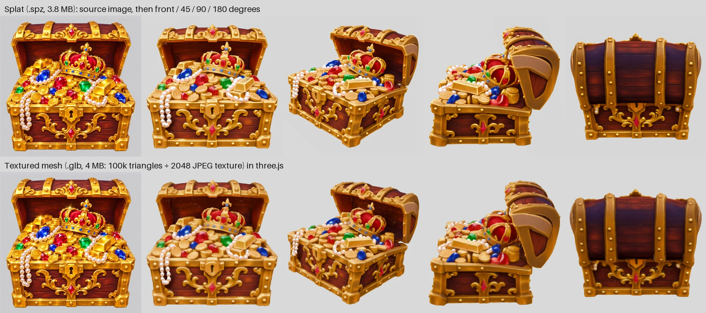

# TripoSplat
TripoSplat converts a single 2D image into high-quality and variable number of 3D Gaussians, developed by [TripoAI](https://www.tripo3d.ai/). It can serve as a powerful pipeline tool for asset creation, AR/VR, game development, simulation environments, and beyond.

<a href="https://arxiv.org/abs/2605.16355"></a>
<a href="https://www.tripo3d.ai/research/triposplat"></a>
<a href="https://huggingface.co/spaces/VAST-AI/TripoSplat"></a>

|  |  |
|---|---|
|  |  |

## Highlights
- **High-quality, versatile generation** that handles a wide range of image styles.
- **Arbitrary Gaussian count** (up to 262,144) — trade off visual quality against rendering cost according to your need.
- **Minimal, readable code**: two files (`triposplat.py` and `model.py`), ~2,000 LOC total. Easy to customize and integrate into other ecosystems.
- **Near-zero dependencies**: no `transformers`, no `diffusers`, no version-conflict hell. Runs on any platform.
- **Official ComfyUI support**: drop the [official workflow template](https://github.com/Comfy-Org/workflow_templates/blob/main/templates/3d_triposplat_image_to_gaussian_splat.json) into ComfyUI and start playing with TripoSplat right away.

## Quickstart
Download model weights to `ckpts/` from [HuggingFace](https://huggingface.co/VAST-AI/TripoSplat). 
```bash
# Use one of the following ways to download model weights.

# 1. Use HuggingFace CLI
hf download VAST-AI/TripoSplat --local-dir ckpts/

# 2. Use huggingface_hub
pip install huggingface_hub
python -c "from huggingface_hub import snapshot_download; snapshot_download(repo_id='VAST-AI/TripoSplat', local_dir='ckpts/')"

# 3. Use ModelScope CLI
pip install modelscope
modelscope download VAST-AI-Research/TripoSplat --local_dir ckpts/

# 4. Use modelscope Python SDK
pip install modelscope
python -c "from modelscope import snapshot_download; snapshot_download('VAST-AI-Research/TripoSplat', local_dir='ckpts/')"

# 5. Manual download from HuggingFace / ModelScope.
```

Setup the environment and run the example inference script.
```bash
# install torch and torchvision according to your environment
pip install numpy safetensors pillow tqdm
python run_example.py
```

The exported `.ply` / `.splat` files can be visualized in any 3D Gaussian
viewer — e.g. [SparkJS](https://sparkjs.dev) or
[SuperSplat](https://superspl.at/editor).


## Neko Legends Gradio App

```bash
pip install gradio
python run_gradio.py
```

If port `7860` is already in use, set `TRIPOSPLAT_PORT` before launching.

The local app provides an image uploader, sampling controls, a Spark.js 3D
Gaussian splat viewer, first-launch Setup popup for downloading the expected
TripoSplat `.safetensors` files, and these exports:

| File | What it is | Chest example |
|---|---|---|
| `<name>.spz` | compressed splat (Spark, three.js) | 3.8 MB |
| `<name>_native.ply`, `.splat` | splat in the standard formats | 17.8 MB, 8.4 MB |
| `<name>_mesh.glb` | **real textured mesh**: 100k triangles + 2048×2048 JPEG texture | 4.0 MB |
| `<name>_point_cloud.glb/.obj/.fbx`, glTF `.zip` | splat centres as a coloured point cloud | 4-17 MB |

The preview switches between **Splat** and **Mesh (.glb)**.



### Real 3D mesh export

TripoSplat makes Gaussian splats, not polygons, so the app also turns every result into an ordinary textured mesh
that Blender, game engines and three.js (`GLTFLoader`) open like any model:

1. the splat is rendered (colour and depth) from 128 directions around the object;
2. the depth maps are fused into a signed-distance volume (TSDF, 256³), with the silhouettes carving away empty space;
3. marching cubes extracts the surface, small floating pieces are dropped, and the mesh is simplified to 100k
   triangles;
4. xatlas unwraps it, and every texel of a 2048×2048 texture takes the colour of the 1024 px splat renders that see
   its surface point most head-on.

The `.glb` is y-up, stands on y = 0 with its front facing +z, and uses an unlit material (`KHR_materials_unlit`):
the texture already contains the shading and highlights of the source image, so lighting it again would wash it
out. About 40 s per object. The texture keeps more detail than a colour per vertex at less than half the size
(left: 514k triangles with vertex colours, 10 MB; right: textured, 4 MB):


It needs the scene worker packages (see [Scene requirements](#scene-requirements)); without them the job still
finishes and reports `meshError`. API options: `"mesh": false` to skip it, `"meshTexture": 4096` for a bigger
texture, `0` for the full-resolution mesh with vertex colours; `--no-mesh` on the command line. Convert any splat
yourself:

```bash
python -m scene_splat --mesh chest_native.ply                     # -> chest_mesh.glb (textured)
python -m scene_splat --mesh chest_native.ply --mesh-texture 0     # vertex colours, no simplification
python -m scene_splat --mesh scene.spz --mesh-up y --mesh-yaw 0    # a .spz that is already y-up
```

Limits: thin parts (cloth, hair, leaves) can close up or get holes, and the lighting is baked in. Making the splat
from a Flux 360 degree video instead of one image was tested and dropped: it was sharper only from the filmed
angles, smeared everywhere else, and Flux reshaped the object while turning.

## AI Agent Control and Headless Mode

ImageToSplat now has suite-style local AI Agent Control. It is off by default,
binds to `127.0.0.1`, defaults to port `17340`, and registers itself in
`%APPDATA%\NekoLegends\agent-api-registry.json` when enabled. Use the
`AI Agent Control` accordion in the app, or start it from the command line:

```powershell
python run_gradio.py --agent-api --no-browser
```

Run only the API, without the Gradio UI:

```powershell
python run_gradio.py --serve-agent-api
```

Run one headless generation job and print JSON output:

```powershell
python run_gradio.py --headless D:\images\chair.png --output-dir D:\splats --output-name chair --num-gaussians 65536
```

Useful environment variables:

- `TRIPOSPLAT_AGENT_API=1` starts the Agent API beside the UI.
- `TRIPOSPLAT_AGENT_API_PORT=17340` overrides the API port.
- `TRIPOSPLAT_HEADLESS=1` enables headless mode.
- `TRIPOSPLAT_OPEN_BROWSER=0` keeps the Gradio UI from opening a browser.

Agent API endpoints:

- `GET /health`
- `GET /openapi.json`
- `GET /status`
- `GET /models`
- `POST /setup`
- `POST /generate`

Example generation request:

```powershell
Invoke-RestMethod -Method Post -Uri http://127.0.0.1:17340/generate -ContentType 'application/json' -Body (@{
  imagePath = 'D:\images\chair.png'
  outputDir = 'D:\splats'
  outputName = 'chair'
  seed = 42
  steps = 20
  guidanceScale = 3.0
  numGaussians = 262144
} | ConvertTo-Json -Depth 4)
```

`POST /generate` returns a `jobId`; poll `GET /status` for progress and final
export paths.

## Room / Scene Mode (experimental: command line and Agent API only)

Single-image mode guesses the hidden sides of one object. Scene mode instead rebuilds a **room or any still scene**
from video, so you can walk through it in three.js:

1. **Video in.** Use your own clips of a still scene (several clips of one room are joined), or let
   [Venice Media Local](https://github.com/neko-legends/venice-media-local) film it:
   - give a room image (or a prompt, and `gpt-image-2-6-sunburst` draws it);
   - Sunburst edit first draws one wide panorama of the whole room, then draws the room from three more directions
     using that panorama, so every view agrees on where things are (views edited one by one put the same bookshelf
     in different places, and the splat then smears the versions together);
   - Flux 3 first/last-frame films a fast 5 s turn from each view to the next, closing the loop
     (`captureMode: "first-last"`, the default), or Seedance 2.5 reference-to-video makes one spin through all
     views (`captureMode: "reference"`). Longer turns (180 degrees in one clip) dissolve, and more, smaller turns
     invent more in-between content, so four 90 degree turns work best.
2. **Every clip is inspected** before use (hard cuts, cross-fades, a camera that barely moves). AI video does not
   always follow the prompt; a Venice clip that fails is filmed again once, and every clip gets a contact sheet in
   `<name>.clips/`.
3. **Camera positions** are solved across all clips with COLMAP (pycolmap, default, best quality). Each frame gets
   its own focal length and lens distortion, because AI video zooms while it moves (one Flux clip drifted 28 % in
   focal length; one shared lens bent the room). The result is levelled (the average camera "up" becomes +y) so the
   viewer starts upright and walking stays on the floor. Alternatively, solve with
   MapAnything (`sfm: "mapanything"`, about twice as fast overall: one GPU pass instead of CPU matching; training then
   also refines each camera). In one 200-frame room test: COLMAP 14 min, 20.2 dB; MapAnything 7.4 min, 19.1 dB.
4. **Splats are trained on the GPU** with gsplat (MCMC, capped splat count, light colour detail). Frames that keep
   disagreeing with the rest (a clip that jumps or morphs for a moment) are dropped part-way through and listed in
   `droppedFrames`; splats sitting on top of a camera and huge blurry blobs are removed. The result is saved as a
   compressed **`.spz`** (a room is about 5-15 MB instead of 350-600 MB of `.ply`) plus `<name>.cameras.json`, the
   filmed camera path in three.js coordinates (y up). The splat is already y-up; load it with Spark
   (`new SplatMesh({ url: "room.spz" })`) and start the player at `cameras[0]`.

The viewer opens a scene with `viewer.html?ply=<room.spz>&cams=<room.cameras.json>`: drag to look around,
W/A/S/D to walk, Q/E down/up.

### Scene requirements

Scene work runs in a separate Python worker so the main app does not need these packages:

```bash
# Python 3.12 environment with CUDA PyTorch for your GPU, then:
pip install -r requirements-scene.txt
python -m scene_splat --check      # reports ffmpeg, pycolmap, torch/CUDA, gsplat
```

gsplat compiles its CUDA kernels on first use, so a CUDA toolkit (`nvcc`) is needed once; the worker finds it via
`CUDA_HOME`, `nvcc` on `PATH`, `/opt/cuda` or `/usr/local/cuda`. Point the app at that environment with
`IMAGETOSPLAT_SCENE_PYTHON=/path/to/python`. `IMAGETOSPLAT_FFMPEG` overrides ffmpeg.

Optional MapAnything solver: install [MapAnything](https://github.com/facebookresearch/map-anything)
(`pip install -e <clone>`) in the worker environment. It uses the Apache 2.0 weights `facebook/map-anything-apache`
(downloaded once from Hugging Face). Its DINOv2 encoder is loaded from a local copy of
[facebookresearch/dinov2](https://github.com/facebookresearch/dinov2) instead of being fetched from GitHub on every
load: put a reviewed copy in `<torch hub dir>/facebookresearch_dinov2_main` (usually
`~/.cache/torch/hub/facebookresearch_dinov2_main`) or set `IMAGETOSPLAT_DINOV2_DIR`.

Venice capture needs Venice Media Local running with Agent Control on. Pass its Agent Control token in the GUI,
as `venice.token` in the request, or set `VENICE_MEDIA_LOCAL_TOKEN` (`VENICE_MEDIA_LOCAL_URL` if it is not on
`http://127.0.0.1:9876`). The Venice API key stays inside Venice Media Local.

Command line:

```bash
python -m scene_splat --video walk1.mp4 --video walk2.mp4 --out scenes --name living-room
python -m scene_splat --capture-image room.png --out scenes --name room   # Flux first/last, 5 s turns
```

Agent API: `GET /scene/check`, then `POST /generate-scene` and poll `GET /status`:

```bash
curl -X POST http://127.0.0.1:17340/generate-scene -H 'Content-Type: application/json' -d '{
  "imagePath": "/path/to/room.png", "captureMode": "first-last", "captureDuration": "5s",
  "venice": {"token": "<Venice Media Local agent token>"},
  "outputName": "room", "maxSplats": 600000, "steps": 20000 }'
```

`videoPaths` replaces `imagePath` for your own clips. Other options: `prompt`, `viewPaths` (your own extra views),
`outputDir`, `fps` (frames taken per second, default 10), `frameWidth`, `steps`, `maxSplats`, `shDegree` (0 or 1),
`device` (e.g. `cuda:1`), `sfm` (`colmap` or `mapanything`), `keepWork`.

## Portable Windows Build

```powershell
.\Build-Portable.ps1
```

The build output is published to `release\portable\NekoSplatForge\NekoSplatForge.exe`.
The app launches first; use the Setup popup to download the TripoSplat model
files into the portable `ckpts` folder before generating.

## License
TripoSplat code and weight models are released under the [MIT License](https://github.com/VAST-AI-Research/TripoSplat/blob/main/LICENSE).

## Citation
If you find TripoSplat useful, please cite:
```bibtex
@misc{yan2026generative3dgaussianslearned,
    title={Generative 3D Gaussians with Learned Density Control}, 
    author={Runjie Yan and Yan-Pei Cao and Peng Wang and Ding Liang and Yuan-Chen Guo},
    year={2026},
    eprint={2605.16355},
    archivePrefix={arXiv},
    primaryClass={cs.GR},
    url={https://arxiv.org/abs/2605.16355}, 
}
```
